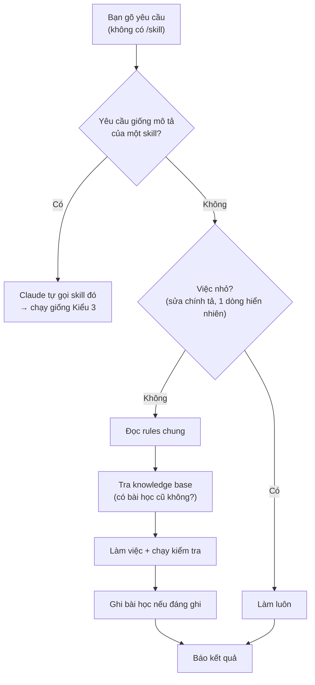
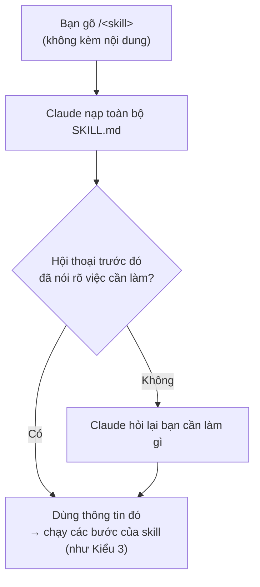
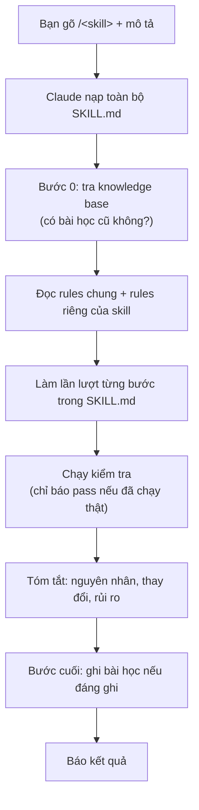
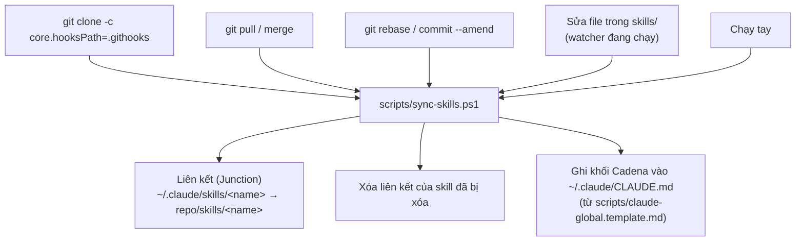

# Luồng chạy khi người dùng gõ chat (Execution flow)

Tài liệu này giải thích: khi bạn gõ một câu vào Claude Code, Claude sẽ làm gì với bộ rules, skills
và knowledge base trong repo này.

Có 3 kiểu gõ:

| Kiểu | Ví dụ | Claude làm gì |
|---|---|---|
| **1. Gõ nội dung bình thường** | `Màn hình Employee Profile lưu bị lỗi, kiểm tra giúp` | Claude **tự đoán** có nên dùng skill không. Có thể dùng, có thể không. |
| **2. Gõ skill trống** | `/fix-bug` | Skill **chắc chắn** được dùng, nhưng Claude chưa biết việc cần làm → lấy từ hội thoại trước đó hoặc hỏi lại. |
| **3. Gõ skill + nội dung** | `/fix-bug Lưu Employee bị NullReferenceException` | Skill **chắc chắn** được dùng và Claude có đủ thông tin để làm ngay. **Nên dùng kiểu này.** |

---

## 1. Trước khi bạn gõ: Claude đã có sẵn gì?

Mỗi khi mở Claude Code, nó **tự động** nạp 3 thứ:

1. `~/.claude/CLAUDE.md`: chỉ ra đường dẫn tới `rules/`, `knowledge/` và danh sách skill.
2. `CLAUDE.md` của project đang mở (nếu có).
3. **Tên và mô tả ngắn** (`description`) của từng skill. Nội dung đầy đủ của `SKILL.md` **chưa** được nạp.

Những thứ còn lại (file rules, knowledge, `SKILL.md`) Claude **tự mở đọc** khi cần, vì hướng dẫn yêu cầu vậy.
Không có cơ chế nào ép buộc bước này, nên mô tả yêu cầu càng rõ thì Claude càng đi đúng quy trình.

---

## 2. Kiểu 1: gõ nội dung bình thường

Ví dụ: `Màn hình Employee Profile mở chậm, kiểm tra giúp.`



Cần biết:
- Claude **có thể không** gọi skill. Khi đó các bước chi tiết của skill (ví dụ "tìm root cause trước khi sửa",
  "thêm regression test") không được nạp. Claude chỉ làm theo rules chung và knowledge base.
- Phù hợp cho: hỏi đáp, việc nhỏ, việc không thuộc skill nào.

---

## 3. Kiểu 2: gõ skill trống

Ví dụ: `/fix-bug`, `/review-code`, `/record-lesson`



Mỗi skill xử lý trường hợp gõ trống khác nhau:

| Skill | Gõ trống có ổn không? |
|---|---|
| `record-lesson` | **Ổn**. Đây là cách dùng bình thường: skill đọc lại hội thoại vừa rồi để ghi bài học. Phải gõ trong cùng session. |
| `review-code` | **Ổn**. Claude thường hiểu là review diff hiện tại, và sẽ nêu rõ phạm vi trước khi review. |
| `move-source` | Claude sẽ hỏi nguồn, đích, phạm vi trước khi làm (skill yêu cầu vậy). |
| `fix-bug`, `enhance-performance`, `new-feature`, `fix-bug-security` | Chỉ ổn nếu bạn **vừa mô tả** vấn đề ở tin nhắn trước. Nếu không, Claude phải hỏi lại → tốn thêm một lượt. |

---

## 4. Kiểu 3: gõ skill + nội dung (khuyến nghị)

Ví dụ: `/fix-bug Bấm Save ở Employee Profile báo NullReferenceException, chỉ xảy ra với nhân viên chưa có Company.`



Rules mà mỗi skill đọc thêm:

| Skill | Đọc thêm |
|---|---|
| `fix-bug` | `rules/common/`, `rules/bug-fixing/` |
| `fix-bug-security` | `rules/security/` (playbook theo loại lỗ hổng), `rules/common/`, `rules/bug-fixing/` |
| `enhance-performance` | `rules/common/`, `rules/performance/` |
| `new-feature` | `rules/common/`, `rules/feature-development/`, đối chiếu input/output với `rules/security/` |
| `review-code` | `rules/common/`, `performance/`, `bug-fixing/`, `feature-development/`, playbook `rules/security/` |
| `move-source` | `rules/common/` |
| `record-lesson` | Chỉ `rules/common/knowledge-base.md` (phần ghi bài học) |

Mọi skill (trừ `record-lesson`) đều **mở đầu** bằng tra knowledge base và **kết thúc** bằng ghi bài học.

Ví dụ các bước của `/fix-bug` (xem [skills/fix-bug/SKILL.md](../skills/fix-bug/SKILL.md)):

```mermaid
flowchart LR
    A0["0. Tra KB"] --> A1["1. Tái hiện lỗi"] --> A2["2. Trace code"] --> A3["3. Đọc rules"]
    A3 --> A4["4. Tách sự thật / giả thuyết"] --> A5["5. Tìm root cause"] --> A6["6. Sửa nhỏ nhất"]
    A6 --> A7["7. Regression test"] --> A8["8. Chạy kiểm tra"] --> A9["9. Tóm tắt"] --> A10["10. Ghi bài học"]
```



---

## 5. So sánh 3 kiểu

| | Kiểu 1: nội dung | Kiểu 2: skill trống | Kiểu 3: skill + nội dung |
|---|---|---|---|
| Có dùng skill không? | Tùy Claude đoán | Chắc chắn | Chắc chắn |
| Claude biết việc cần làm? | Có | Chỉ khi hội thoại trước đã nói | Có |
| Làm đủ các bước của skill? | Chỉ khi Claude gọi skill | Có | Có |
| Tra / ghi knowledge base | Có, với việc không tầm thường | Có | Có |
| Nên dùng khi | Hỏi đáp, việc nhỏ | `/record-lesson`, `/review-code`, hoặc ngay sau khi đã mô tả vấn đề | Sửa lỗi, tối ưu, tính năng mới, security, di chuyển code |

Cả 3 kiểu đều phải tuân thủ `CLAUDE.md` của project đích. Nếu nó mâu thuẫn với rules dùng chung,
Claude nên nêu ra và hỏi bạn.

---

## 6. Ví dụ cho từng skill

Cú pháp: `/<tên-skill> <mô tả>`. Mô tả càng cụ thể (màn hình, URL, nguyên văn lỗi, file, branch)
thì càng dễ khớp bài học cũ trong knowledge base.

### `fix-bug`: sửa lỗi

```text
/fix-bug Bấm Save ở Staffing > Employee Profile báo "Object reference not set to an instance of an object".
Stack trace: EmployeeProfileGeneralView.ascx.cs line 412. Lỗi chỉ xảy ra với nhân viên chưa có Company.
```

```text
/fix-bug Báo cáo Payroll Summary tháng 09/2026 ra tổng Net Pay thấp hơn tổng chi tiết 1.250.000.
Chỉ sai với company có nhiều cost center.
```

Kết quả: root cause, bản sửa nhỏ nhất, regression test (nếu được), kết quả build/test thật, đường dẫn bài học (nếu có).

### `enhance-performance`: tối ưu hiệu năng

```text
/enhance-performance Form Employee Profile (FormID 8601E363-E701-42B1-9A5E-A3F700A5BACD) mở lần đầu mất ~8 giây,
chọn nhân viên cũng chậm. Cần giảm thời gian tải mà không đổi hành vi.
```

```text
/enhance-performance Stored procedure usp_GetTimesheetByPeriod chạy 40s khi có 5.000 nhân viên.
Xem execution plan và đề xuất index hoặc viết lại query.
```

Kết quả: điểm nghẽn (có số đo nếu đo được, hoặc ghi rõ "tìm bằng đọc code"), thay đổi, ảnh hưởng, cách kiểm chứng.

### `fix-bug-security`: audit và sửa lỗ hổng bảo mật

```text
/fix-bug-security Pentest báo HTML injection (CWE-80) ở /Staffing/EmployeeProfile, field "Remark".
Payload: <a href="https://evil.example">Click</a> được render thành link trong email thông báo.
```

```text
/fix-bug-security Chỉ audit, chưa sửa: kiểm tra toàn repo các chỗ ghép chuỗi SQL từ input người dùng.
```

Lưu ý: skill làm 2 giai đoạn. Audit xong sẽ **dừng lại chờ bạn duyệt** rồi mới sửa.
Thêm "chỉ audit" nếu chỉ cần báo cáo.

### `new-feature`: tính năng mới

```text
/new-feature Thêm nút "Export Excel" cho grid danh sách hợp đồng ở Staffing > Contract.
Xuất đúng các cột đang hiển thị và filter hiện tại, giới hạn 50.000 dòng.
```

```text
/new-feature Tạo API POST /api/leave-requests/{id}/cancel cho phép nhân viên hủy đơn nghỉ chưa duyệt.
Chỉ người tạo đơn được hủy; ghi audit log.
```

Kết quả: kế hoạch ngắn, code theo convention của project, validation/authorization, kết quả build/test thật.

### `review-code`: review code

```text
/review-code
```

```text
/review-code Review branch feature/leave-cancel so với main, tập trung vào performance và các caller bị ảnh hưởng.
```

```text
/review-code Review file Handlers/GetEmployeeFullNamesByEmployeeIDsQueryHandler.cs và các nơi gọi nó.
```

Lưu ý: chỉ review, không sửa code trừ khi bạn yêu cầu.

### `move-source`: di chuyển source code

```text
/move-source Chuyển các thay đổi chưa commit liên quan TigerConnect từ branch develop sang release/5.2.
Branch đích cũ hơn, cần kiểm tra các class và constructor còn tồn tại không.
```

```text
/move-source Chuyển thư mục Modules/Cadena.Modules.Staffing/Reports sang project Cadena.Modules.Reporting,
cập nhật namespace, using và file .csproj.
```

Lưu ý: nếu nguồn, đích hoặc phạm vi chưa rõ, Claude sẽ hỏi trước. Thay đổi chưa commit ở đích không bị ghi đè.

### `record-lesson`: ghi bài học

Dùng ở cuối tác vụ, trong **cùng session** (skill đọc lại hội thoại).

```text
/record-lesson
```

```text
/record-lesson Ghi lại bài học vụ Employee Profile tải chậm, nhấn mạnh hướng đi sai về DefaultBankID.
```

Kết quả: đường dẫn file bài học (mới, hoặc cập nhật bài cũ cùng root cause). Claude không commit; bạn tự review, commit, push.

### Mẹo

- Dán **nguyên văn** thông báo lỗi và stack trace (knowledge base tìm theo từ khóa này).
- Nói rõ phạm vi: màn hình, URL, branch, file, khoảng commit.
- Nói rõ giới hạn: "chỉ audit", "chưa sửa", "không đổi hành vi", "không thêm dependency".
- Có thể nối skill: `/fix-bug ...` → `/review-code` → `/record-lesson` (nếu chưa tự ghi bài học).

---

## Phụ lục: skill và rules được đồng bộ vào `~/.claude` thế nào

Phần này chạy ngầm, trước mọi session. Bạn thường không cần quan tâm.



- Sửa `SKILL.md` trong repo: **có hiệu lực ngay** (nhờ Junction).
- Sửa `scripts/claude-global.template.md`: phải chạy lại `sync-skills.ps1` (watcher không theo dõi file này).
- `rules/` và `knowledge/`: Claude đọc trực tiếp từ repo, không cần sync.
- Hook git nằm ở `.githooks/post-checkout` (chỉ chạy khi clone), `.githooks/post-merge` và `.githooks/post-rewrite`.
